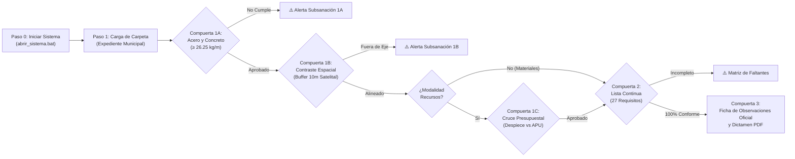

# Manual e Instructivo Oficial de Uso del Sistema SIPRO-PH
## Sistema de Revisión y Priorización Técnico-Documental de Proyectos de Placa Huella

**Entidad:** Gobernación de Antioquia — Secretaría de Infraestructura Física  
**Dirección:** Dirección de Infraestructura Física y Apoyo Territorial  
**Desarrollado por:** Isabela Ramírez Restrepo & Ronaldo Rubio Rodríguez  
**Estándar Normativo:** Criterios Técnicos de Pavimentos con Placa-huella (Cuantía Mínima: 26.25 kg/m)  
**Versión de Publicación:** 2026 — Guía de Operación y Supervisión Técnica  

---

> [!WARNING]
> ### ⚠️ DECLARACIÓN VINCULANTE: ROL DEL SUPERVISOR Y ALCANCE DEL SOFTWARE
> **El programa SIPRO-PH es una herramienta tecnológica de asistencia, cálculo paramétrico y agilización del tamizaje preliminar de expedientes.**  
> 
> **EN NINGÚN CASO EL PROGRAMA REEMPLAZA LAS FUNCIONES, EL CRITERIO PROFESIONAL NI LA RESPONSABILIDAD LEGAL, CIVIL O PENAL DEL INGENIERO SUPERVISOR O AUDITOR.**
> 
> El software realiza sumatorias matemáticas y comprobaciones analíticas sobre los documentos físicos aportados por la entidad municipal. No obstante, **es deber ineludible y legal del profesional supervisor:**
> 1. **Inspeccionar visualmente cada plano y despiece estructural:** Constatar escalas, notas de especificación de materiales, traslapos mínimos ($0.54\text{ m}$ para varilla #3 y $0.72\text{ m}$ para #4), ganchos estándar a 135° ($0.16\text{ m}$) y separación de riostras de confinamiento ($3.00\text{ m}$).
> 2. **Verificar la autenticidad documental:** Comprobar que las firmas autógrafas o digitales y las matrículas COPNIA de los proyectistas sean legítimas y vigentes.
> 3. **Validar la concordancia en terreno:** Corroborar que la georreferenciación satelital y el trazado vial concuerden con la realidad topográfica, sin afectación de rondas hídricas, predios de terceros ni zonas de alto riesgo geotécnico.
> 4. **Comprobar la legalidad administrativa:** Constatar que los actos administrativos (Acuerdo de facultades del Concejo, personerías, vigencias de paz y salvos) pertenezcan al mes calendario en curso.
> 5. **Refrendar el dictamen final:** El supervisor humano es el único facultado para firmar y emitir el Concepto Técnico de Viabilidad o Subsanación.

---

## 1. Arquitectura del Flujo Secuencial en Línea ("Gatekeepers Pipeline")

El software opera bajo una secuencia lógica de compuertas de control temprano. Si una compuerta anterior presenta fallas críticas, el sistema alerta de inmediato antes de que el supervisor gaste tiempo evaluando documentos posteriores.



---

## 2. Catálogo de Referencias Visuales (Botones y Partes de la Interfaz)

Para facilitar la navegación y el uso del programa, a continuación se describen los botones y componentes que interactúan en la interfaz:

| Control / Botón | Representación Visual | Ubicación en Pantalla | Función y Acción que Ejecuta |
| :--- | :--- | :--- | :--- |
| **Cargar Carpeta Municipio** | `[📁 Cargar Carpeta Municipio]` *(Verde bosque con ícono de carpeta)* | Cabecera Superior y Barra Lateral | Abre el cuadro de diálogo del sistema operativo para seleccionar la carpeta física con todos los archivos del proyecto (PDFs, Excel, KMZ). |
| **Conmutador de Modalidad** | `[🧱 MATERIALES]` / `[💰 RECURSOS]` | Cabecera Superior (junto a Cargar) | Alterna la naturaleza de cofinanciación: **MATERIALES** (evalúa 27 ítems) o **RECURSOS** (activa la Compuerta 1C y el Ítem 28 de Presupuesto). |
| **Selector de Proyecto** | Desplegable `Expediente: [ Municipio ... ]` | Cabecera Superior | Permite alternar instantáneamente entre múltiples municipios cargados en la misma sesión sin perder datos ni estado de auditoría. |
| **Nombrar Expediente** | `[✏️ Nombrar Expediente]` *(Botón secundario)* | Cabecera y Banner Activo | Abre el modal interactivo para corregir o complementar el nombre del municipio, código de radicado, subregión, alcalde y secretario. |
| **Guardar Avance** | `[💾 Guardar Avance]` *(Verde esmeralda)* | Cabecera Superior y Pestaña F3 | Guarda el archivo `sipro_auditoria.json` en la carpeta física del proyecto, preservando todas las observaciones editadas y hallazgos manuales. |
| **Pista de Compuertas** | Badges `[1A]` `[1B]` `[1C]` `[F2]` `[F3]` | Banner Superior de Navegación | Semáforos interactivos que indican el estado de cada fase (Verde: Conforme, Rojo: Detención). Al hacer clic en un badge se viaja a su pestaña. |
| **Zoom Tramos Proyecto** | `[🎯 Ir a Tramos / Zoom Proyecto]` | Pestaña Fase 1B (Mapa) | Centra automáticamente el mapa Google Satelital Híbrido sobre las coordenadas geográficas exactas de la placa huella municipal. |
| **Subir Red Vial** | `[📤 Subir / Actualizar Red Vial]` *(Azul cian)* | Pestaña Fase 1B (Mapa) | Permite subir un archivo GeoJSON personalizado de la red vial en caso de no contar con conexión directa a los servicios de ArcGIS R10. |
| **Capas Viales** | `[● Red Terciaria]` `[● Trazado KML]` `[● Buffer 10m]` `[📏 Cota al Eje]` | Barra Multicapa de Fase 1B | Enciende o apaga de forma independiente cada capa geográfica y los vectores de distancia perpendicular hacia el eje vial. |
| **Filtros de Requisitos** | `[Todos]` `[Solo Conformes]` `[Por Subsanar]` | Pestaña Fase 2 (Lista) | Filtra la tabla de 27 requisitos para visualizar únicamente los pendientes de subsanación o los aprobados. |
| **Inspección Digital** | `[👁️ Ver Documento]` *(En cada fila)* | Pestaña Fase 2 (Lista) | Despliega el visor modal PDF en pantalla completa para inspeccionar visualmente firmas, fechas, sellos y contenido del documento aportado. |
| **Ficha PDF Oficial** | `[📄 Exportar / Imprimir Ficha de Observaciones]` | Cabecera y Pestaña Fase 3 | Compila e imprime el reporte institucional oficial en formato PDF con membrete de la Gobernación de Antioquia y tabla de observaciones. |

---

## 3. Guía Paso a Paso en Línea: Desde el Inicio hasta la Ficha Final

### Paso 0: Puesta en Marcha del Sistema
1. En la carpeta del aplicativo, haga doble clic sobre el archivo ejecutable **`abrir_sistema.bat`**.
2. El sistema iniciará automáticamente el servidor local en segundo plano (puerto `8085`) y abrirá su navegador web en la dirección:
   ```
   http://localhost:8085/index.html
   ```
3. Para apagar el servidor al finalizar la jornada, haga doble clic en **`detener_sistema.bat`**.

---

### Paso 1: Carga y Parametrización del Expediente Municipal
1. En la cabecera superior, presione el botón **`📁 Cargar Carpeta Municipio`**.
2. En la ventana emergente de Windows, seleccione la carpeta raíz que contiene la documentación del municipio.
3. El motor **`folderReader.js`** procesará los archivos en memoria y realizará:
   - Extracción de texto y lectura de la Ficha de Priorización.
   - Cotejo del nombre del municipio contra la base de datos oficial de los **125 municipios de Antioquia**.
   - Identificación de subregión, tramos viales y presupuesto estimado.
4. **Verificación de Modalidad:**
   - Si el convenio es de entrega de materiales (cemento y acero), seleccione **`🧱 MATERIALES`**.
   - Si el convenio contempla giro presupuestal en dinero, seleccione **`💰 RECURSOS`**.
5. Si el nombre del municipio o el código de radicado no se detectaron automáticamente debido a escaneos de baja resolución, presione **`✏️ Nombrar Expediente`** y complete la información en el modal.

---

### Paso 2: Revisión de la Compuerta 1A (Control Estructural de Acero y Concreto)
Haga clic en la pestaña **`Fase 1A: Control Estructural de Acero`**.

#### ¿Qué evalúa el sistema automáticamente?
- Lee el archivo del **Ítem 3** (`Despiece de Acero y Memorias de Concreto`) en formato Excel (`.xlsx`) o PDF.
- Extrae las marcas de despiece (longitudes, diámetros #2, #3, #4, #5 y cantidades).
- Calcula la cuantía real de acero por metro lineal:
  $$	ext{Cuantía (kg/m)} = rac{\sum (	ext{Longitud}_i 	imes 	ext{Masa Lineal Nominal}_i)}{	ext{Longitud del Tramo (m)}}$$
- Compara el resultado frente al umbral normativo departamental de **$26.25	ext{ kg/m}$**.
- Calcula paramétricamente la memoria de volúmenes de concreto ($21	ext{ MPa}$ y ciclópeo) y el requerimiento de sacos de cemento (rendimiento de $pprox 7.0	ext{ a }7.5	ext{ sacos/m}$).

> [!IMPORTANT]
> #### 👮 REVISIÓN OBLIGATORIA DEL SUPERVISOR EN COMPUERTA 1A
> - Abra el plano de despiece original y compruebe que la armadura corresponda a una banca estándar de $4.30	ext{ m}$ (huellas de $0.90	ext{ m}$, ciclópeo central de $0.90	ext{ m}$, cunetas de $0.70	ext{ m}$ / $0.15 	imes 0.20	ext{ m}$).
> - Verifique que los traslapos cumplan: mínimo **$0.54	ext{ m}$** para varilla #3 y **$0.72	ext{ m}$** para varilla #4.
> - Compruebe que la longitud de ganchos a 135° sea de al menos **$0.16	ext{ m}$**.
> - Constaste que la separación entre riostras transversales no supere los **$3.00	ext{ m}$**.
> - Valide que el plano contenga la firma y matrícula COPNIA del Ingeniero Civil proyectista.

---

### Paso 3: Revisión de la Compuerta 1B (Contraste Espacial y Alineación Vial en Satélite)
Haga clic en la pestaña **`Fase 1B: Contraste Espacial y Alineación Vial`**.

#### ¿Qué evalúa el sistema automáticamente?
- Descomprime el archivo del **Ítem 24** (`.kmz` o `.kml`) y proyecta los tramos y puntos sobre la capa de **Google Satelital Híbrido**.
- Contrasta las coordenadas contra la **Red Vial Terciaria Oficial de Antioquia** (mediante conexión con ArcGIS FeatureServer R10 o GeoJSON local).
- Aplica un **buffer de tolerancia de 10 metros** respecto al eje vial departamental.
- Mide la distancia de cada punto al eje vial más próximo y coteja el código de vía reportado en el informe contra el `CODIGO_VIA` oficial del inventario.

> [!IMPORTANT]
> #### 👮 REVISIÓN OBLIGATORIA DEL SUPERVISOR EN COMPUERTA 1B
> - Presione el botón **`🎯 Ir a Tramos / Zoom Proyecto`** para centrar el mapa satelital.
> - Revise visualmente la ortofoto satelital para asegurar que el trazado no afecte rondas de ríos o quebradas, zonas de reserva ecológica ni predios privados sin faja vial cedida.
> - Compruebe que la vía corresponda verdaderamente a la red terciaria municipal y no a una vía secundaria o privada.
> - Si un tramo aparece marcado como "Fuera de Vía" (>10 m), investigue si se trata de una variante no inventariada o de una deficiencia del levantamiento topográfico con GPS de baja precisión.

---

### Paso 4: Revisión de la Compuerta 1C (Coherencia Presupuestal — Solo Modalidad Recursos)
Si el proyecto se configuró en modalidad **`💰 RECURSOS`**, haga clic en la pestaña **`Fase 1C: Coherencia Presupuestal`**.

#### ¿Qué evalúa el sistema automáticamente?
- Lee el **Ítem 28** (`Presupuesto Oficial y APUs`) y el **Ítem 2** (`Especificaciones Técnicas`).
- Ejecuta una regla de exclusión para descartar preliminares, movimientos de tierra y concretos pobres de limpieza (solados).
- Extrae y totaliza los volúmenes de concreto estructural de $21	ext{ MPa}$ ($3.000	ext{ PSI}$), concreto ciclópeo y kilogramos de acero figurado.
- Ejecuta el **cruce tripartito de cantidades**: compara el presupuesto oficial con la memoria analítica de la Compuerta 1A y alerta sobre diferencias superiores al $5\%$.

> [!IMPORTANT]
> #### 👮 REVISIÓN OBLIGATORIA DEL SUPERVISOR EN COMPUERTA 1C
> - Verifique que los Precios Unitarios (APUs) guarden estricta relación con la tabla oficial de precios de referencia de la Secretaría de Infraestructura Física.
> - Asegúrese de que no existan partidas duplicadas entre subbase, afirmado y concreto.
> - Compruebe que el AIU contractual no sobrepase los topes legales establecidos para convenios territoriales.

---

### Paso 5: Revisión de la Compuerta 2 (Validación Documental Continua — 27 Requisitos)
Haga clic en la pestaña **`Fase 2: Validación Documental`**.

#### ¿Qué evalúa el sistema automáticamente?
- Evalúa la presencia física de los 27 documentos reglamentarios (o 28 en modalidad Recursos).
- Comprueba la vigencia de los archivos basándose en sus fechas de expedición:
  - Documentos del **mes calendario en curso ($\le 30	ext{ días}$):** RUT, Antecedentes de Procuraduría y Contraloría, Consulta PACO, Medidas Correctivas Policía y REDAM.
  - Documentos con vigencia de **$90	ext{ días}$:** Certificados de vías y declaraciones juradas.
  - Documentos con vigencia de **$180	ext{ días}$:** Diseños, cronogramas y memorias técnicas.
- Asigna un semáforo de estado:
  - `✓ Conforme` (Verde): Documento aportado y dentro de la vigencia permitida.
  - `⚠️ Vencido` (Amarillo): Documento aportado pero con fecha que supera el plazo máximo.
  - `✗ Faltante` (Rojo): Archivo no encontrado en la carpeta municipal.

> [!IMPORTANT]
> #### 👮 REVISIÓN OBLIGATORIA DEL SUPERVISOR EN COMPUERTA 2
> - Haga clic en el botón **`👁️ Ver Documento`** de cada fila para abrir el visor PDF en pantalla completa.
> - Verifique que la fotocopia de la cédula del alcalde sea totalmente legible y coincida exactamente con la persona mencionada en el acta de posesión.
> - Compruebe que el **Acuerdo del Concejo Municipal** faculte *expresa e inequívocamente* al alcalde para celebrar convenios interadministrativos en la vigencia fiscal presente.
> - Compruebe que los certificados de antecedentes judiciales, disciplinarios y fiscales indiquen taxativamente **"NO REPORTA"** o **"NO REGISTRA SANCIÓN"**.
> - Verifique que los paz y salvos de parafiscales estén firmados por el Revisor Fiscal o Representante Legal debidamente acreditado.

---

### Paso 6: Compuerta 3, Ficha de Observaciones Oficial y Salidas Técnicas
Haga clic en la pestaña **`Fase 3: Salidas, Ficha y Dictamen`**.

#### ¿Qué consolida el sistema automáticamente?
- Agrupa todas las no conformidades y detenciones detectadas en las compuertas 1A, 1B, 1C y Fase 2.
- Separa claramente:
  - **Matriz de Hallazgos y No Conformidades:** Ítems faltantes o no aceptados que deben remitirse al municipio para subsanación.
  - **Requisitos Conformes:** Ítems aprobados (visibles en bloque colapsable).
- Permite editar en tiempo real la redacción de los motivos para personalizar las instrucciones de subsanación.
- Permite adicionar observaciones técnicas no estructuradas mediante el botón **`➕ Agregar Hallazgo Manual`**.

#### Acciones Finales del Supervisor:
1. **Revisar y afinar motivos:** Ajuste el texto de las observaciones para que el municipio entienda claramente qué ajuste debe realizar en el plano, presupuesto o documento.
2. **Definir el Concepto Técnico Global:** Seleccione una de las tres opciones institucionales:
   - **`FAVORABLE`:** Únicamente si el $100\%$ de las compuertas y requisitos están aprobados.
   - **`FAVORABLE CON CONDICIONES`:** Si los hallazgos son menores y subsanables antes del acta de inicio.
   - **`NO FAVORABLE / REQUIERE SUBSANACIÓN`:** Si existen detenciones estructurales (1A), espaciales (1B) o faltan documentos legales sustanciales.
3. **Guardar Trazabilidad:** Presione el botón **`💾 Guardar Avance en Carpeta`** para que se genere el archivo `sipro_auditoria.json` con todas las modificaciones.
4. **Emitir Ficha de Observaciones Oficial en PDF:** Presione el botón **`📄 Exportar / Imprimir Ficha de Observaciones (PDF)`** (o el botón en la cabecera superior `Ficha PDF (Fase 3)`). Se desplegará la vista de impresión con membrete institucional de la Gobernación de Antioquia, lista para imprimir o guardar como PDF oficial.

---

## 4. Matriz Normativa de Referencia: Los 27 Requisitos Documentales

| Ítem | Denominación Oficial del Requisito | Entidad Responsable | Regla Técnica y Jurídica | Vigencia Exigida |
| :---: | :--- | :--- | :--- | :---: |
| **01** | Solicitud formal del alcalde a la Secretaría | Alcaldía Municipal | Nombre, firma, cédula y período constitucional vigente. | $\le 60	ext{ días}$ |
| **02** | Esquema de especificaciones técnicas | Ingeniero Proyectista | Firma autógrafa/digital y matrícula profesional COPNIA verificable. | $\le 180	ext{ días}$ |
| **03** | Despiece de acero y memorias de concreto | Proyectista Estructural | Cuantía $\ge 26.25	ext{ kg/m}$, cálculo de marcas y volumen de cemento. | $\le 180	ext{ días}$ |
| **04** | Certificado de vías a intervenir como terciarias | Secretaría de Obras | Coincidencia de código con el inventario de la Red Terciaria. | $\le 90	ext{ días}$ |
| **05** | Acta de socialización comunitaria | JAC / Alcaldía | Firmas legibles de beneficiarios directos de la vereda. | $\le 180	ext{ días}$ |
| **06** | Registro fotográfico a color | Equipo Técnico | Mínimo 8 tomas georreferenciadas del estado de la banca. | $\le 90	ext{ días}$ |
| **07** | Cédula de ciudadanía del alcalde | Registraduría Nacional | Documento legible coincidente con las actas oficiales. | Constitucional |
| **08** | Acta de posesión del alcalde | Notaría / Juzgado | Protocolización del período de mandato constitucional. | Constitucional |
| **09** | Acuerdo del Concejo de facultades para contratar | Concejo Municipal | Facultades expresas expedidas en el mes calendario en curso. | Mes en curso |
| **10** | Copia del RUT del municipio | DIAN | Estado Activo, NIT correcto y expedido en el mes en curso. | Mes en curso |
| **11** | Certificado de Responsables Fiscales | Contraloría General | Estado: NO REPORTADO (Alcalde y Municipio). | Mes en curso |
| **12** | Certificado de Medidas Correctivas (RNMC) | Policía Nacional | Sin sanciones de convivencia pendientes en el sistema RNMC. | Mes en curso |
| **13** | Certificado de Antecedentes Judiciales | Policía Nacional | Sin asuntos pendientes con las autoridades judiciales. | Mes en curso |
| **14** | Certificado de Antecedentes Disciplinarios | Procuraduría General | Sin sanciones ni inhabilidades disciplinarias vigentes. | Mes en curso |
| **15** | Paz y salvo de parafiscales y seguridad social | Revisor Fiscal / Tesorero | Pagos al día suscrito por profesional habilitado. | Mes en curso |
| **16** | Certificado REDAM (Deudores Alimentarios) | MinTIC / MinJusticia | Estado: NO REGISTRA deuda alimentaria morosa. | Mes en curso |
| **17** | Compromiso anticorrupción (Anexo) | Alcaldía Municipal | Formato institucional debidamente diligenciado y firmado. | $\le 90	ext{ días}$ |
| **18** | Declaración de no lavado de activos (LA/FT) | Alcaldía Municipal | Declaración jurada de prevención de LA/FT firmada. | $\le 90	ext{ días}$ |
| **19** | Declaración de inhabilidades e incompatibilidades | Alcaldía Municipal | Manifestación expresa bajo gravedad de juramento. | $\le 90	ext{ días}$ |
| **20** | Declaración de no multas ni sanciones | Alcaldía Municipal | Certificación de no caducidad contractual ni multas vigentes. | $\le 90	ext{ días}$ |
| **21** | Consulta en Portal Anticorrupción PACO | Presidencia - PACO | Generado en el mes en curso sin registros sancionatorios. | Mes en curso |
| **22** | Inhabilidades por delitos sexuales (Ley 1918) | Policía Nacional | Estado: NO REGISTRA INHABILIDAD expedido en el mes. | Mes en curso |
| **23** | Certificado de banco de proyectos (BPIN) | Planeación Municipal | Registro MGA / BPIN municipal activo con viabilidad. | $\le 180	ext{ días}$ |
| **24** | Georreferenciación de tramos (KMZ / KML) | Topografía / SIG | Vectorial GPS alineado a la Red Terciaria ($\le 10	ext{ m}$). | $\le 180	ext{ días}$ |
| **25** | Cronograma de ejecución y contratación | Secretaría de Obras | Plazo coherente con la vigencia del convenio propuesto. | $\le 180	ext{ días}$ |
| **26** | Articulación con Plan de Desarrollo | Planeación Municipal | Certificado de concordancia con metas del plan local. | $\le 180	ext{ días}$ |
| **27** | Certificado de financiación y contrapartida | Hacienda Municipal | Cierre financiero: aportes departamentales y municipales. | $\le 90	ext{ días}$ |

---

## 5. Preguntas Frecuentes y Solución de Incidencias Técnicas

### ¿Qué hacer si el sistema no lee automáticamente el nombre del municipio?
Si el documento de la Ficha de Priorización fue escaneado como imagen de baja calidad, el motor OCR del navegador podría no reconocer el texto. En este caso, haga clic en el botón **`✏️ Nombrar Expediente`** de la cabecera superior y seleccione manualmente el municipio del listado oficial de Antioquia.

### ¿Por qué la cuantía en la Compuerta 1A marca 0.00 kg/m?
Ocurre si el archivo de despiece no fue aportado en la carpeta o si el archivo Excel no posee las columnas estándar de longitud, masa lineal y diámetros. Remita al municipio el formato oficial ubicado en `Base/Plantilla_Estandar_Despiece_Acero_Gobernacion.xlsx`.

### ¿Por qué la Compuerta 1B muestra que el proyecto está "Fuera de Vía"?
El umbral de tolerancia departamental es de **10 metros** respecto al eje vial. Si el trazado satelital se desvía más de 10 metros, revise si el levantamiento topográfico fue tomado sobre un tramo desviado o si se trata de una rectificación de curvas que requiere nota aclaratoria en el informe topográfico.

### ¿Se pueden auditar varios municipios al mismo tiempo?
Sí. El botón **`➕ Cargar Otro Municipio`** permite abrir múltiples expedientes en una misma sesión. Para alternar entre ellos, haga clic en los chips de pestañas superiores o seleccione el municipio en el menú desplegable `Expediente: [ ... ]`.

---
*Gobernación de Antioquia — Secretaría de Infraestructura Física*  
*Dirección de Infraestructura Física y Apoyo Territorial*  
*SIPRO-PH · Sistema de Revisión y Priorización Técnico-Documental de Placa Huellas*
